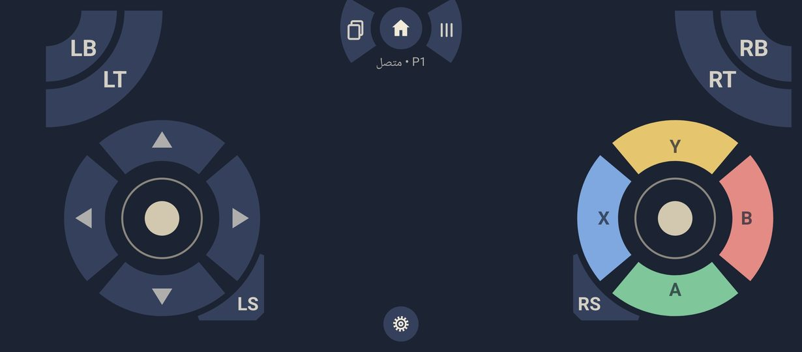
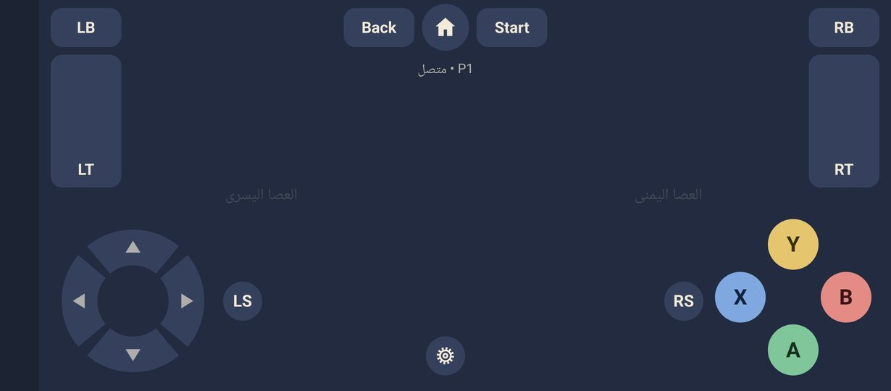
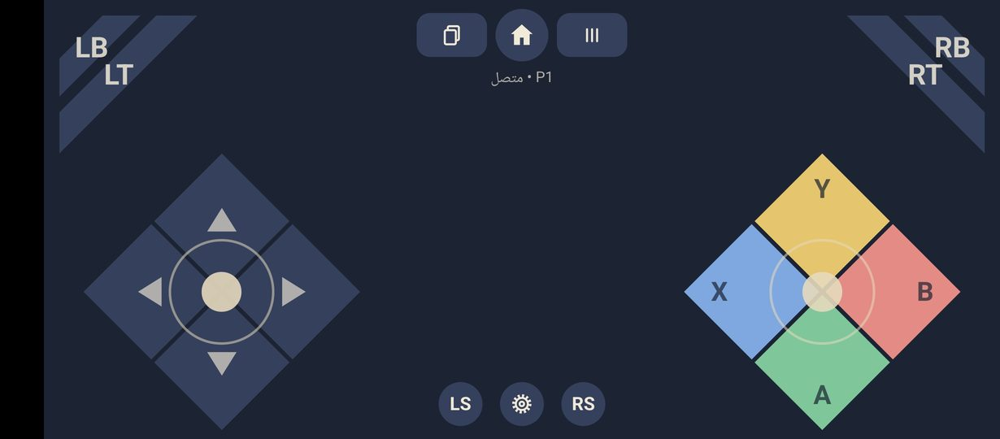

# DOpad

**حوّل هاتفك إلى ذراع Xbox 360 افتراضية — بلا تطبيق، بلا إعلانات، بلا شهادات.**

[English](README.md) · [العربية](README.ar.md)

الـ`DOpad` هو خادم صغير يعمل على **لينكس (uinput)** أو **ويندوز (ViGEm Bus)** وينشئ ذراع Xbox 360 افتراضية على حاسوبك. يتصل به هاتفك عبر **WebSocket على HTTP العادي**: افتح العنوان (أو امسح رمز QR)، واضغط **ابدأ**، والعب. يعمل على كل متصفحات الهاتف الحديثة، بما فيها **Safari وBrave على الأيفون**.

المشروع كله مكتوب بالمكتبة المعيارية للغة Go: **بلا cgo وبلا أي مكتبة Go خارجية**. وعلى ويندوز يُحمَّل `ViGEmClient.dll` عبر `syscall`.

<p align="center">
  
</p>

| Classic                                               | Diamond                                               |
| ----------------------------------------------------- | ----------------------------------------------------- |
|  |  |

---

## الفهرس

1. [المميزات](#المميزات)
2. [البدء السريع](#البدء-السريع)
3. [المتطلبات](#المتطلبات)
4. [الاستخدام](#الاستخدام)
5. [وضع نقطة الوصل (بدون راوتر)](#وضع-نقطة-الوصل-بدون-راوتر)
6. [وضع البلوتوث (بدون واي فاي)](#وضع-البلوتوث-بدون-واي-فاي)
7. [الإعدادات](#الإعدادات)
8. [ملاحظات ويندوز](#ملاحظات-ويندوز)
9. [ملاحظات لينكس](#ملاحظات-لينكس)
10. [تخصيص التخطيطات](#تخصيص-التخطيطات)
11. [طريقة العمل](#طريقة-العمل)
12. [لماذا WebSocket وليس WebRTC](#لماذا-websocket-وليس-webrtc)
13. [ملاحظات الأمان](#ملاحظات-الأمان)
14. [البناء من المصدر](#البناء-من-المصدر)
15. [هيكل المشروع](#هيكل-المشروع)
16. [حل المشاكل](#حل-المشاكل)
17. [جُرّب على](#جُرّب-على)
18. [المساهمة والرخصة](#المساهمة-والرخصة)

---

## المميزات

- **بلا تطبيق ولا إعلانات ولا حساب.** المتحكم صفحة ويب يقدّمها البرنامج نفسه.
- **يعمل على كل متصفحات الهاتف الحديثة** عبر HTTP العادي: Chrome والمتصفحات المبنية على Firefox وSafari وBrave، على أندرويد وأيفون.
- **عصي عائمة.** حلقة العصا تظهر **تحت إبهامك** عند أول لمسة وتُقاس الحركة منها، فلا تحتاج النظر إلى الشاشة لتجد مكانها.
- **تخطيطات قابلة للتخصيص بالكامل** بملفات JSON: ارتكاز، دوائر، معينات، أقواس، مضلعات حرة، مزالق تناظرية، وعنصر `pad` موحّد يجمع الأزرار والمزالق حول مركز مشترك.
- **التثبيت (latch).** اضغط أي زر مدة محددة فيبقى مضغوطًا حتى تنقر عليه مرة أخرى.
- **عدة لاعبين.** حتى 16 ذراعًا افتراضية (6 افتراضيًا)، خانة لكل هاتف.
- **صغير وخفيف.** ملف واحد مستقل، بضعة آلاف أسطر، وحزم من 8 بايت.
- **وضع نقطة وصل مدمج (لينكس)** — الحاسوب نفسه يصبح نقطة Wi-Fi مع خادم DHCP مدمج، بلا راوتر ولا إنترنت.
- **وضع البلوتوث (`-b`)** — نفس الصفحة ونفس حزم الـ 8 بايت عبر البلوتوث بدل الواي فاي. يعمل مع أندرويد وآيفون، بلا تطبيق على الهاتف، ولا يتعارض مع واي فاي أي من الجهازين.
- **رمز QR** يُطبع في الطرفية ويُقدَّم PNG على المسار `/qr`.
- **لوحة تحكم محلية (`dopad-panel`).** واجهة متصفح صغيرة مرتبطة بـ
  `127.0.0.1` تبدّل أوضاع Wi‑Fi والبلوتوث وSelf، وتشغّل الخادم وتوقفه، وتعرض
  السجل ورمز QR الحيّ، وتحرّر التخطيطات وتصدّرها. وهي مضمّنة في كل حزمة.
- **الشاشة تبقى مضاءة** أثناء اللعب (Screen Wake Lock مع فيديو صامت بديل على HTTP العادي).
- **قابل للتثبيت كتطبيق ويب** على الأيفون لتجربة شاشة كاملة حقيقية.

---

## البدء السريع

### نسخة جاهزة

**لينكس**

```bash
./DOpad
```

**ويندوز**

1. ثبّت برنامج تشغيل **ViGEmBus** من [صفحة الإصدارات](https://github.com/nefarius/ViGEmBus/releases) ثم أعيد تشغيل الحاسوب.
2. شغّل `DOpad.exe` ووافق على نافذة جدار الحماية (UAC) المرة الأولى.

عند التشغيل يطبع البرنامج شيئًا مثل:

```
Interface: /home/user/dopad/web, Players: 6

... رمز QR ...

Open 🎮DOpad on browser: http://192.168.1.42:8080
```

افتح العنوان على الهاتف (نفس شبكة Wi-Fi)، واختار اللاعب والتخطيط، ثم اضغط **ابدأ**.

> يجب أن يبقى الملف التنفيذي بجانب مجلد `layouts/`. وتحتاج حزم الواجهة الخارجية أيضًا إلى `web/`، أما الحزم المضمّنة فتحمل الواجهة داخل الثنائي. ويمكن تحديد مكانهما بـ`DOPAD_WEB` و`DOPAD_LAYOUTS`.

### من المصدر

```bash
make build        # يبني ./DOpad و ./dopad-panel
./DOpad           # تشغيل خادم لوحة اللعب
./dopad-panel     # اختياري: لوحة التحكم المحلية
```

انظر [البناء من المصدر](#البناء-من-المصدر).

---

## المتطلبات

| المتطلب       | التفاصيل                                                                                               |
| ------------- | ------------------------------------------------------------------------------------------------------ |
| نظام الحاسوب  | **لينكس** (uinput) **أو** **ويندوز** (ViGEm Bus)                                                       |
| الشبكة        | الهاتف والحاسوب على **نفس الشبكة المحلية**، أو [وضع نقطة الوصل](#وضع-نقطة-الوصل-بدون-راوتر) (لينكس) أو [وضع البلوتوث](#وضع-البلوتوث-بدون-واي-فاي) |
| البلوتوث (اختياري) | وضع `-b`: هاتف أندرويد/آيفون مقترن مع تفعيل مشاركة الاتصال بالبلوتوث أو نقطة الاتصال الشخصية. على لينكس يلزم أيضًا NetworkManager/BlueZ (أو الجذر مع `bluez-tools` وعميل DHCP) |
| المنفذ        | TCP **8080** افتراضيًا (يجرّب حتى 8090 إذا كان مشغولًا)                                                |
| Go            | `go >= 1.24` — فقط عند البناء من المصدر                                                                |
| صلاحيات لينكس | الوصول إلى `/dev/uinput` (انظر [ملاحظات لينكس](#ملاحظات-لينكس))                                        |
| ويندوز        | برنامج تشغيل **ViGEmBus**، وملف `ViGEmClient.dll` (x64) بجانب الـexe أو مضمّن وقت البناء               |

---

## الاستخدام

1. من القائمة الرئيسية اختار **خانة اللاعب** و**التخطيط** ثم اضغط **ابدأ**. يُحفظ اختيارك في الهاتف.
2. لكل خانة ذراع افتراضية ثابتة. إن اختار هاتف ثانٍ خانة مشغولة فإنه يأخذها، ويعرض الهاتف الأول خيار «استعادة»، ولا تتغير الذراع في اللعبة.
3. تُنشأ الأذرع بالترتيب (P1 ثم P2 …)، فاختار **P1 أولًا** كي تطابق أرقام اللاعبين في الألعاب.
4. أيقونة الترس (أو زر القائمة في التخطيط) تفتح قائمة اللعب: **متابعة**، **إنهاء ملء الشاشة**، **القائمة الرئيسية**.

### الشاشة الكاملة على الأيفون

لا يسمح أي متصفح على الأيفون بإخفاء أشرطة Safari برمجيًا. للحصول على شاشة كاملة حقيقية:

1. افتح صفحة DOpad في **Safari**.
2. اضغط **مشاركة** ثم **إضافة إلى الشاشة الرئيسية**.
3. شغّل **DOpad** من الأيقونة الجديدة.

عندها تُفتح بلا أشرطة متصفح وتحترم النوتش والمناطق الآمنة. وعلى الأندرويد والآيباد يعمل زر «ملء الشاشة» مباشرة.

### إبقاء الشاشة مضاءة

أثناء اللعب يطلب DOpad **Screen Wake Lock**. ولأن هذه الواجهة تتطلب سياقًا آمنًا (HTTPS أو `localhost`)، يشغّل أيضًا فيديو صامتًا صغيرًا (`wake.webm` / `wake.mp4`) كبديل يعمل مع `http://192.168…`. وقد يمنع **وضع الطاقة المنخفضة** في الهاتف كليهما، وعندها يُطبَّق سلوك الجهاز الافتراضي دون أي خطأ.

### رمز QR

يطبع الخادم العنوان كرمز QR نصي في الطرفية، وتجد نسخة PNG على `http://<ip>:8080/qr`.

---

## وضع نقطة الوصل (بدون راوتر)

```bash
sudo ./DOpad -s
# نقطة وصل مباشرة:  SSID=DOPad  كلمة المرور=12345678
# ثم رمز QR وسطر:
# Open 🎮DOpad on browser: http://192.168.50.1:8080
```

يحوّل `-s` الحاسوب **نفسه** إلى نقطة وصل Wi-Fi (مع خادم DHCP مدمج). مفيد عند غياب الراوتر أو الإنترنت. هو **للينكس فقط**، ويحتاج **صلاحيات الجذر**، ويعتمد على **NetworkManager** (`nmcli`). اضغط `Ctrl+C` مرة واحدة: تتوقف نقطة الوصل ويعود اتصال Wi-Fi الأصلي.

> كلمة مرور نقطة الوصل الافتراضية هي `12345678`. **اختار كلمة خاصة بك** عبر `DOPAD_PASS` (انظري [ملاحظات الأمان](#ملاحظات-الأمان)).

على ويندوز لا يُدعم `-s`؛ شغّل الخادم عاديًا على شبكتك المحلية.

---

## وضع البلوتوث (بدون واي فاي)

```bash
./DOpad -b
```

ينقل `-b` نفس الصفحة ونفس حزم الـ 8 بايت عبر **البلوتوث بدل الواي فاي**. الهاتف هو من يوفّر وصلة الشبكة والحاسوب عميل — وهو التقاطع الوحيد الذي يعمل على لينكس وويندوز وأندرويد وآيفون بلا تطبيق على الهاتف.

**اقترن بالهاتف أولًا**، ثم شغّل `./DOpad -b`:

- **أندرويد:** فعّل **مشاركة الاتصال بالبلوتوث** (الإعدادات ← الشبكة والإنترنت ← نقطة الاتصال والمشاركة ← مشاركة الاتصال بالبلوتوث).
- **آيفون:** فعّل **نقطة الاتصال الشخصية ← السماح للآخرين بالانضمام**، ثم اقترن من إعدادات البلوتوث في الحاسوب (تشترط Apple تفعيل البيانات الخلوية لهذه الميزة).

**الخادم يعمل فورًا** ويستمر مع **صفر هاتف متصل** — لا ينتظر ولا يفشل ولا يطلب منك الاستعجال. وفي الخلفية يعيد المحاولة مع كل هاتف مقترن، ويطبع رابط الهاتف ورمز QR لحظة نجاح الوصلة.

- **عدة هواتف:** يُعلَن كل هاتف على حدة عند اتصاله. على لينكس يمكن اتصال أكثر من هاتف في الوقت نفسه (ملف NetworkManager مستقل لكل هاتف). أما ويندوز فيدير **رابط بلوتوث واحدًا في كل مرة**، وينتقل إلى هاتف آخر تلقائيًا إن فشل الأول.
- اقترن بهاتف جديد، أو أزل اقترانًا، أو فعّل/أوقف المشاركة في أي لحظة: لا حاجة لإعادة التشغيل.

وإذا تشارك هاتفان نفس الشبكة الفرعية (آيفونان يستخدمان `172.20.10.0/28` معًا)، يُبقي البرنامج الأول ويطبع تحذيرًا واضحًا بدل إخفاء التعارض.

**الواي فاي لا يُمس إطلاقًا.** لا جسر ولا توجيه ولا مسار افتراضي عبر البلوتوث، فيبقى إنترنت الحاسوب على واي فاي الخاص به وإنترنت الهاتف على حاله. السيناريوهات الأربعة كلها تعمل كما هي:

| واي فاي الحاسوب | واي فاي الهاتف | إنترنت الحاسوب | إنترنت الهاتف | الصفحة عبر البلوتوث |
|---|---|---|---|---|
| يعمل | متوقف | نعم | لا | تعمل |
| متوقف | يعمل | لا | نعم | تعمل |
| يعمل | يعمل | نعم | نعم | تعمل |
| متوقف | متوقف | لا | لا | تعمل |

ملاحظات وقيود:

- **لينكس:** يستخدم **NetworkManager** ولا يحتاج **أي صلاحيات** عادةً (`ipv4.never-default=yes` يضمن عدم التوجيه). وإن كانت توزيعتك تقيّد NetworkManager على المستخدمين ذوي الصلاحيات، أضف مستخدمك إلى مجموعة `network` أو شغّله بـ`sudo`. وإن لم يكن NetworkManager موجودًا (خادم بلا سطح مكتب) يرجع إلى **نمط الجذر** — `sudo ./DOpad -b` عبر `bluez-tools` وعميل DHCP — ويقول ذلك صراحةً.
- **ويندوز:** الاقتران إجراء مستخدم عادي، أما حذف المسار الافتراضي للبلوتوث فيحتاج صلاحية مسؤول. شغّل البرنامج كمسؤول إن أردت ضمانًا قاطعًا بعدم مرور أي حزمة عبر البلوتوث.
- **استثناء الآيفون:** iOS لا يوفّر شبكة بلوتوث إلا عبر «نقطة الاتصال الشخصية»، وهي تشترط تفعيل البيانات الخلوية. لذا صف «لا إنترنت إطلاقًا» مستحيل على الآيفون — وهذا قيد iOS لا قيد DOpad.
- `DOPAD_BT=<MAC>` يحدّد هاتفًا معيّنًا عند اقتران أكثر من واحد.
- `DOPAD_BT_IFACE=<iface>` يستخدم واجهة بلوتوث جاهزة (إعداد يدوي أو نمط الجذر).

---

## الإعدادات

كل الإعدادات متغيرات بيئة:

| المتغير | الوصف | الافتراضي |
|---|---|---|
| `DOPAD_PORT` | منفذ الاستماع | `8080` |
| `DOPAD_ADDR` | العنوان المعروض للهاتف (الوضع العادي فقط) | كشف تلقائي |
| `DOPAD_PLAYERS` | عدد الخانات (1–16) | `6` |
| `DOPAD_WEB` | مجلد الواجهة | بجانب الملف التنفيذي |
| `DOPAD_LAYOUTS` | مجلد التخطيطات | `layouts/` بجانب مجلد الواجهة |
| `DOPAD_IFACE` | واجهة اللاسلكي لوضع نقطة الوصل | أول واجهة لاسلكية |
| `DOPAD_SSID` / `DOPAD_PASS` | اسم نقطة الوصل وكلمة مرورها | `DOPad` / `12345678` |
| `DOPAD_BAND` / `DOPAD_CHANNEL` | نطاق نقطة الوصل وقناتها (2.4GHz أفضل توافقًا) | `bg` / `6` |
| `DOPAD_SUBNET` | بادئة الشبكة الفرعية لنقطة الوصل | `192.168.50` |
| `DOPAD_BT` | عنوان البلوتوث للهاتف المستخدم في الوضع `-b` | أول هاتف مقترن |
| `DOPAD_BT_IFACE` | استخدام واجهة بلوتوث جاهزة (إعداد يدوي/جذر) | غير محدد |

خيارات سطر الأوامر: `-s` (وضع نقطة الوصل)، `-b` (وضع البلوتوث). وهناك خيار داخلي `-fix-firewall` يستخدمه مساعد جدار الحماية على ويندوز.

إن كان المنفذ 8080 مشغولًا أو محجوبًا يجرّب DOpad المنافذ التالية حتى 8090 ويحدّث الرابط والرمز المطبوعين. وإن فشلت كلها يطلب منك اختيار منفذ بـ `DOPAD_PORT`.

---

## ملاحظات ويندوز

يحتاج DOpad على ويندوز إلى **شيئين مختلفين**:

- **برنامج تشغيل ViGEmBus** — ثبّته من [صفحة الإصدارات](https://github.com/nefarius/ViGEmBus/releases) ثم أعيد التشغيل.
- **ملف `ViGEmClient.dll` (x64)** — **لا** يأتي مع مثبّت ViGEmBus. ضعه بجانب `DOpad.exe`، أو **ضمّنه داخل الملف**: ضعه في `server/ViGEmClient.dll` قبل `make build-windows` فيصير `DOpad.exe` ملفًا واحدًا جاهزًا للتوزيع.

عند التشغيل يفحص البرنامج الأمرين ويطبع بالضبط ما الناقص. وإن رفض الخادم إنشاء الذراع تظهر الرسالة نفسها على الهاتف مع زر **إعادة المحاولة**.

**جدار الحماية.** في أول تشغيل يطلب البرنامج إذن المسؤول **مرة واحدة** (UAC) ويضيف قاعدة سماح لنفسه (كل أنواع الشبكات، للأجهزة في الشبكة المحلية فقط) ويحذف أي قاعدة حظر قديمة. إن رفضت فشغّله مرة واحدة بالزر الأيمن ← «تشغيل كمسؤول».

**تعيين الأزرار والمحاور.** بتات الأزرار من الهاتف تطابق `wButtons` في XInput تمامًا، فلا حاجة لجدول تحويل. وتُحوَّل المحاور إلى `int16` (`XUSB_REPORT`، 12 بايت). الأعلى موجب في الهاتف وفي XInput، فلا تُعكس المحاور العمودية.

---

## ملاحظات لينكس

يستخدم DOpad الملف `/dev/uinput` و`ioctl` مباشرة (بلا cgo). ويفحص الوصول مبكرًا عند التشغيل ويطبع رسالة واضحة مرة واحدة إن فشل.

في بعض التوزيعات يعمل مباشرة. وإن ظهر تحذير عن `/dev/uinput` شغّل مرة واحدة:

```bash
make setup
```

يضيف هذا قاعدة udev (تتيح `/dev/uinput` لمجموعة `input`) ويضيف مستخدمك إلى المجموعة `input`. قد تحتاج لتسجيل الخروج والدخول من جديد.

---

## تخصيص التخطيطات

التخطيط **ملف `.json` واحد** داخل مجلد `layouts/`. يصف **ما الموجود على الشاشة وأين وبأي حجم**. أما ألوان العناصر وأشكالها فمشتركة بين كل التخطيطات (`controls.css`). لا حاجة لإعادة البناء ولا لإعادة تشغيل الخادم.

### طريقة العمل

1. انسخ `layouts/classic.json` إلى اسم جديد مثل `layouts/mine.json`.
2. غيّر `"name"` — هذا الاسم الظاهر في القائمة (إن حذفه ظهر اسم الملف).
3. **حدّث صفحة الهاتف مرة واحدة** ليظهر الملف الجديد في قائمة التخطيطات.
4. اختاره واضغط **ابدأ**.

وللتعديلات اللاحقة على الملف نفسه لا حاجة لتحديث الصفحة: يُقرأ التخطيط عند الضغط على **ابدأ**. افتح قائمة اللعب ← **القائمة الرئيسية** ← **ابدأ** من جديد.

الملف المعطوب (فاصلة زائدة، تعليق، اقتباس ناقص) يُتجاهل، ويكتب الخادم في سجله سطرًا يبدأ بـ«تخطيط معطوب» مع اسم الملف. JSON لا يقبل التعليقات ولا الفاصلة بعد آخر عنصر.

### بنية الملف

```json
{
  "name": "الاسم الظاهر في القائمة",
  "elements": [
    { "type": "button", "key": "A", "label": "A", "shape": "round", "color": "a",
      "w": 13, "anchor": "br", "x": 18, "y": 4 }
  ]
}
```

الـ`elements` هو قائمة مرتبة. لكل عنصر `type` من: `panel` أو `button` أو `trigger` أو `stick` أو `pad`. النوع غير المعروف يُتجاهل مع تحذير في console. وإن لم يوجد زر قائمة (`"action": "menu"`) يضيف التطبيق واحدًا تلقائيًا أسفل المنتصف حتى لا تعلقي داخل التخطيط.

### الموضع والحجم والطبقات

**وحدة `u`.** كل الأرقام بوحدة `u` وهي تقريبًا **1% من ارتفاع الشاشة المرئية** (ويحدّها أيضًا 0.55% من العرض على الشاشات الضيقة). لذلك يتكيف التخطيط مع حجم الهاتف، ويُصمَّم للوضع الأفقي. والقيمة النصية مثل `"50%"` تعني نسبة من الشاشة نفسها.

**الارتكاز.** `anchor` يحدد نقطة الاسناد، و`x` و`y` إزاحة **من تلك النقطة نحو داخل الشاشة**.

| `anchor` | نقطة الاسناد |
|---|---|
| `tl` / `tr` | الزاوية العلوية اليسرى / اليمنى |
| `bl` / `br` | الزاوية السفلية اليسرى / اليمنى |
| `tc` / `bc` | منتصف الحافة العلوية / السفلية (يتمركز العنصر أفقيًا) |
| `cc` | منتصف الشاشة تمامًا |

الافتراضي `tl`.

- مع `tl`: `x` يدفع لليمين و`y` للأسفل. ومع `br`: `x` يدفع لليسار و`y` للأعلى.
- مع `tc` و`bc` و`cc`: `x` الموجب يحرّك العنصر لليمين والسالب لليسار من المنتصف.
- القيم السالبة مسموحة وتُخرج العنصر عن الحافة (تُستخدم لوضع مركز `pad` في الزاوية).
- الارتكاز الأيمن والأيسر يضيف تلقائيًا هامش المنطقة الآمنة (النوتش)، فلا يختفي شيء خلفه.

**الحجم.** `w` و`h` للعرض والارتفاع. الأزرار `shape: "round"` تأخذ `w` فقط (مربعة). و`size` يصلح فقط مع `stick` و`pad`. الافتراضات: لوحة 20×20، زر `pill` 18×10، زر دائري `w=12`، مزلاق 18×34، صندوق عصا 40.

**الطبقات (`z`).** اختيارية لكل عنصر. **الأعلى يُرسم فوق ويأخذ اللمس أولًا**، وعند التساوي يفوز الأحدث في الملف. الافتراضات: `panel` = 0، `stick` مع `area` = 1، `stick` مع صندوق = 4، وكل الباقي = 3. ولهذا يلتقط الزر لمسته قبل منطقة العصا التي تحته.

### أنواع العناصر

#### `panel` — زينة (بلا لمس)

| الخاصية | الوصف |
|---|---|
| `fill` | `true` لتعبئة الخلفية |
| `edge` | `"left"` أو `"right"` لرسم خط فاصل على ذلك الجانب |
| `label` | نص باهت في المنتصف (مثل «العصا اليسرى») |

#### `button` — زر

| الخاصية | الوصف |
|---|---|
| `key` | `A B X Y LB RB BACK START HOME LS RS UP DOWN LEFT RIGHT` |
| `action` | `"menu"` لزر القائمة (بدل `key`) |
| `label` | النص (الافتراضي هو `key`) |
| `icon` | `home` أو `view` أو `menu` أو `gear` (بدل النص) |
| `shape` | `pill` (الافتراضي) أو `round` |
| `color` | `a` أخضر، `b` أحمر، `x` أزرق، `y` أصفر |
| `latch` | مللي ثانية للضغط قبل التثبيت (انظري أدناه) |

الزر بلا `key` صالح ولا `action` يُتجاهل مع تحذير في console.

#### `trigger` — مزلاق تناظري (LT / RT)

القيمة **من 0 إلى 255** حسب موضع إصبعك داخل المستطيل. أول إصبع يلمسه **يبقى مرتبطًا به** حتى الرفع حتى لو خرج عن حدوده، وتتشبع القيمة عند أقرب طرف.

| الخاصية | الوصف |
|---|---|
| `key` | `LT` أو `RT` |
| `label` | النص (الافتراضي هو `key`) |
| `at` | `[x, y]` نسبة مئوية لتحريك النص داخل المستطيل |
| `dir` | اتجاه التعبئة (الجدول أدناه) |

| `dir` | تمتلئ من | اسحبي للزيادة |
|---|---|---|
| `top` (الافتراضي) | الأعلى | للأسفل |
| `bottom` | الأسفل | للأعلى |
| `left` | اليسار | لليمين |
| `right` | اليمين | لليسار |

(`up` و`down` مقبولتان كبديلين.)

#### `stick` — عصا عائمة

عند أول لمسة تقفز الحلقة **تحت إبهامك** وتُقاس الحركة منها. وعند الرفع تعود إلى مكانها الساكن أو تختفي.

منطقة اللمس إما:

- **`area`**: `"left"` أو `"right"` — نصف الشاشة كاملًا (الأنسب للتخطيط الكلاسيكي)، أو
- **صندوق**: `anchor` و`x` و`y` و`size` (أو `w`/`h`)، مع `reach` وهو نسبة نصف القطر التي يجوز بدء اللمس فيها (الافتراضي 1).

| الخاصية | الوصف | الافتراضي |
|---|---|---|
| `side` | أي عصا تتحكم بها: `left` / `right` | `left` |
| `ring` | قطر الحلقة | 36 |
| `knob` | قطر المقبض | 0.43 × `ring` |
| `travel` | أقصى إزاحة للمقبض عن نقطة اللمس | نصف `ring` |
| `rest` | رسم الحلقة وهي ساكنة | `true` مع الصندوق، `false` مع `area` |

#### `pad` — الإطار الموحّد

`pad` أقوى العناصر: مساحة مربعة بإحداثيات **من 0 إلى 100** ومركز مشترك `(50, 50)`، تجمع **أجزاء**. كل جزء زر أو مزلاق بشكل قوس أو مضلع حول المركز. منه صُنعت الأسهم وABXY وأكتاف الزوايا في تخطيطي Ring وDiamond.

خصائص الإطار:

| الخاصية | الوصف | الافتراضي |
|---|---|---|
| `size` أو `w` / `h` | الحجم | 40 |
| `metric` | `circle` أو `diamond` (قياس البعد قطريًا أو بمجموع المحورين) | `circle` |
| `spread` | تسامح الزاوية حول `angle` بالدرجات | 60 |
| `inner` | نسبة المنطقة الميتة في المنتصف | 0.2 |
| `reach` | نسبة الحد الخارجي للمس | 1.08 |
| `grow` | تسامح البعد حول `arc` | 6 |

إذا ذكرت `inner` أو `reach` على الإطار صراحة فإنهما يحلان محل الحدود المشتقة من `arc` لكل جزء (هكذا تعمل الأسهم وABXY). والمنطقة الميتة تلتقط اللمس أيضًا، فيمكنك وضع `stick` بنفس الصندوق فوق الإطار واستخدام المنتصف كعصا.

خصائص الجزء:

| الخاصية | الوصف |
|---|---|
| `type` | `button` (الافتراضي) أو `trigger` |
| `key` | الزر (أو مصفوفة أزرار) |
| `angle` | الاتجاه بالدرجات: **0 أعلى، 90 يمين، 180 أسفل، 270 يسار** (يُشتق من الشكل إن حُذف) |
| `arc` | `[r1, r2, a0, a1]` — نصف القطر الداخلي، نصف القطر الخارجي، زاوية البداية، زاوية النهاية (مطلقة، ويصح السالب مثل `-40`) |
| `poly` | `"x,y x,y …"` — مضلع حر بدل `arc` |
| `sweep` | `[a0, a1]` — مدى الزاوية للمضلعات (يُحسب تلقائيًا إن حُذف) |
| `color`, `label`, `icon` | كما في الأزرار |
| `at` | `[x, y]` موضع النص داخل الإطار (الافتراضي مركز الشكل) |
| `fs` | حجم الخط |
| `arrow` | `true` لرسم سهم باتجاه `angle` |
| `latch` | مدة التثبيت بالمللي ثانية |

الجزء بلا `arc` ولا `poly` يبقى بلا شكل مرئي. و`trigger` داخل الإطار **يجب** أن يملك `arc` أو `poly` وإلا يُتجاهل مع تحذير. و`arc` و`poly` غير مدعومين على زر مستقل.

اتجاه تعبئة المزلاق داخل الإطار (`dir`):

- `cw` / `ccw` — تعبئة قطاعية تدور مع الشكل، والقيمة تتبع **زاوية** الإصبع (الافتراضي للأقواس).
- `out` / `in` — تعبئة شعاعية من الداخل للخارج أو العكس.
- `top` `bottom` `left` `right` — تعبئة خطية داخل الصندوق المحيط بالشكل (الافتراضي للمضلعات).

للكتف الأيسر العلوي استخدم `anchor: "tl"` وزوايا قرب `90..180`. وللكتف الأيمن العلوي `anchor: "tr"` وزوايا `180..270` مع `"dir": "ccw"` لتبدأ التعبئة من الحافة العلوية.

عندما تتداخل أجزاء في الاتجاه نفسه (زر داخلي ومزلاق خارجي) يفوز الجزء الذي **نطاقه `r1..r2` الأقرب**. وعند تساوي المسافات (أقطار الأسهم) تُعتمد كل الأجزاء المطابقة معًا، فتحصلين على الاتجاهات القطرية.

**عصا داخل الإطار.** ضعي `pad` ثم `stick` بنفس `anchor` و`x` و`y` و`size` وبـ`reach` أصغر (مثل `0.4`). اللمس قرب المنتصف يحرّك العصا، واللمس قرب الأطراف يضغط أجزاء الإطار.

### التثبيت `latch`

خاصية اختيارية لأي زر (ولأجزاء `pad`) بالمللي ثانية:

- **اضغط وأبق إصبعك** المدة المحددة ← يبقى الزر مضغوطًا بعد رفع الإصبع (ويتوهج للدلالة على ذلك).
- **نقرة واحدة** عليه تحرّره.
- النقرة القصيرة العادية تعمل كالمعتاد.
- تُحرَّر كل الأزرار المثبتة تلقائيًا عند فتح القائمة أو انقطاع الاتصال، فلا يعلق شيء.

```json
{ "type": "button", "key": "LS", "label": "LS", "shape": "round", "w": 10,
  "anchor": "bl", "x": 47, "y": 18, "latch": 500 }
```

قيم مناسبة: `500` لـLS (الجري)، و`150` لأزرار الأكتاف.

### وصفات جاهزة

**تخطيط أدنى يعمل**

```json
{
  "name": "بسيط",
  "elements": [
    { "type": "stick", "side": "left",  "area": "left" },
    { "type": "stick", "side": "right", "area": "right" },
    { "type": "button", "key": "A", "label": "A", "shape": "round", "color": "a", "w": 14, "anchor": "br", "x": 6,  "y": 6 },
    { "type": "button", "key": "B", "label": "B", "shape": "round", "color": "b", "w": 14, "anchor": "br", "x": 22, "y": 14 },
    { "type": "button", "key": "LB", "label": "LB", "anchor": "tl", "x": 3, "y": 3 },
    { "type": "trigger", "key": "LT", "anchor": "tl", "x": 3, "y": 16, "w": 18, "h": 30 }
  ]
}
```

**مزلاق RT عمودي يُسحب للأعلى**

```json
{ "type": "trigger", "key": "RT", "anchor": "tr", "x": 3, "y": 14, "w": 16, "h": 40, "dir": "bottom" }
```

**أكتاف قريبة من الإبهام** (فوق منطقة العصا بدل الزاوية)

```json
{ "type": "button",  "key": "LB", "label": "LB", "anchor": "bl", "x": 4, "y": 46, "w": 16 },
{ "type": "trigger", "key": "LT", "anchor": "bl", "x": 4, "y": 58, "w": 16, "h": 30 }
```

**تخطيط لليسراويين:** بدّل كل `l` و`r` في `anchor`، وبدّل `side` و`area`، واعكس قيم `angle` في الإطارات.

### الأخطاء الشائعة

| المشكلة                   | السبب                                                     |
| ------------------------- | --------------------------------------------------------- |
| الملف لا يظهر في القائمة  | JSON غير صالح، أو لم تحدّث صفحة الهاتف بعد إضافته         |
| التعديل لا يظهر           | لم تعود للقائمة الرئيسية وتضغط **ابدأ** من جديد           |
| زر لا يعمل                | `key` مفقود أو ليس اسمًا صحيحًا بحروف كبيرة               |
| مزلاق داخل `pad` غير ظاهر | ينقصه `arc` أو `poly`                                     |
| العصا تسرق لمسة زر        | طبقة الزر أدنى — ارفعي `z` للزر                           |
| العنصر خارج الشاشة        | راجع إشارة `x` و`y` بالنسبة لارتكازك (الإزاحة نحو الداخل) |

للتشخيص افتح الصفحة بـ`?debug=1` لترى عدد اللمسات وأحداثها أعلى الشاشة. وكل تحذيرات التخطيط تُكتب في console المتصفح (على أندرويد يمكن قراءتها عبر التنقيح عن بعد في كروم).

---

## طريقة العمل

1. يقدّم الخادم الواجهة من `web/` على القرص (أو من نسخة مضمّنة بُنيَت بالوسم `webembed`) على `/`.
2. عند **ابدأ** يفتح المتصفح `ws://host:8080/ws?slot=N`.
3. تحوّل الصفحة اللمسات إلى حالة وترسلها كحزمة ثنائية من **8 بايت**:

| البايتات | النوع | المحتوى |
|---|---|---|
| 0–1 | `int8` | العصا اليسرى X, Y |
| 2–3 | `int8` | العصا اليمنى X, Y |
| 4–5 | `uint16` (little-endian) | بتات الأزرار |
| 6 | `uint8` | LT |
| 7 | `uint8` | RT |

بتات الأزرار (مطابقة لـ`wButtons` في XInput):

| الزر | البت | الزر | البت |
|---|---|---|---|
| UP | `0x0001` | LB | `0x0100` |
| DOWN | `0x0002` | RB | `0x0200` |
| LEFT | `0x0004` | HOME | `0x0400` |
| RIGHT | `0x0008` | A | `0x1000` |
| START | `0x0010` | B | `0x2000` |
| BACK | `0x0020` | X | `0x4000` |
| LS | `0x0040` | Y | `0x8000` |
| RS | `0x0080` | | |

4. يرسل الهاتف حزمة **كلما تغيّرت الحالة** (مرة لكل إطار رسم) إضافةً إلى **نبضة احتياطية كل 50 ملي ثانية** تعوّض الحزم الضائعة. يكتبها الخادم على الذراع الافتراضية (uinput على لينكس، ViGEm على ويندوز). وتُعكس المحاور العمودية على لينكس لأن uinput يعدّ الأعلى سالبًا.
5. عند انقطاع الاتصال تُعاد الذراع إلى الوضع المحايد فلا يعلق أي إدخال.

مسارات HTTP: `/` (الواجهة)، `/ws` (WebSocket)، `/api/layouts` (قائمة التخطيطات)، `/layouts/` (ملفات التخطيط)، `/slots` (حالة الخانات)، `/manifest.webmanifest`، `/qr` (رمز QR كـPNG).

في وضع البلوتوث (`-b`) يوفّر الهاتف شبكة PAN (NAP) وينضم الحاسوب كعميل PANU. ويستمع الخادم نفسه (HTTP/WebSocket) على عنوان IPv4 لواجهة PAN؛ بلا جسر Wi-Fi وبلا مسار افتراضي.

خادم WebSocket مكتوب يدويًا وفق المعيار (`crypto/sha1` و`encoding/binary` و`net`). حجم الإطار محدود بـ64KB، والإطارات المجزأة غير لازمة لرسائل 8 بايت، ويستخدم خادم HTTP مهلة لقراءة الترويسة ضد اتصالات Slowloris.

---

## لماذا WebSocket وليس WebRTC

كل المتصفحات على **iOS** (Safari وChrome وBrave — كلها تستخدم WebKit) تتطلب **سياق HTTPS آمنًا** لاستخدام WebRTC (`RTCPeerConnection`). أي أن الحل التقليدي يتطلب توليد شهادة موقّعة ذاتيًا وإرسالها للهاتف والوثوق بها في الإعدادات — احتكاك كبير.

أما **WebSocket على HTTP** يتجاوز كل هذا: بلا شهادة، وكل متصفح يدعمه، وبلا إعداد على الهاتف، ومنفذ TCP واحد بدل نطاق من منافذ UDP. وبيانات اللعبة صغيرة (8 بايت)، فعلى الشبكة المحلية لا يُلاحَظ الفرق عن UDP.

---

## ملاحظات الأمان

- صُمّم DOpad **لشبكتك المنزلية أو نقطة الوصل الخاصة بك**. **لا توجد مصادقة**: أي جهاز على الشبكة نفسها يفتح الصفحة يستطيع أخذ خانة لاعب.
- الاتصال HTTP عادي؛ لا تستخدمه على شبكات عامة أو غير موثوقة.
- كلمة مرور نقطة الوصل الافتراضية (`12345678`) معروفة للجميع. **اضبط `DOPAD_PASS`** قبل استخدام `-s` في مكان قد يوجد فيه آخرون قريبون.
- قاعدة جدار الحماية على ويندوز تقتصر على الشبكة المحلية.
- وضع البلوتوث (`-b`) لا يتصل إلا بهواتف مقترنة مسبقًا بالحاسوب، والهاتف هو من يوفّر وصلة PAN. ولا توجد مصادقة على مستوى التطبيق، لذا استخدمه مع أجهزتك فقط.

---

## البناء من المصدر

```bash
make build            # ملف لينكس: ./DOpad و ./dopad-panel
make build-panel      # لوحة التحكم المحلية فقط: ./dopad-panel
make build-windows    # ملف ويندوز: ./DOpad.exe (تجميع عابر من لينكس)
make setup            # لينكس: قاعدة udev + مجموعة input (مرة واحدة، عند الحاجة)
make dist             # أربعة مجلدات جاهزة للتشغيل في dist/ (انظر أدناه)
```

وعلى ويندوز مباشرة (cmd):

```bat
cd server
set CGO_ENABLED=0
go build -trimpath -ldflags="-s -w" -tags vigemdll -o DOpad.exe .
```

احذف `-tags vigemdll` إن فضّلت إبقاء `ViGEmClient.dll` بجانب `DOpad.exe` بدل تضمينه.

إن وُجد `server/ViGEmClient.dll` فإن `make build-windows` يضمّنه عبر الوسم `vigemdll`، فينتج `DOpad.exe` ملفًا واحدًا.

**نسختان لكل نظام.** ينتج `make dist` النسختين معًا في أربعة مجلدات تحت `dist/` (يُعاد إنشاء المجلد في كل تشغيل، ويُؤخذ الإصدار من آخر وسم Git ويمكن تجاوزه بـ`make dist V=1.2.3`):

| المجلد | الواجهة | المحتوى |
|---|---|---|
| `dist/DOpad-<version>-linux/` | مضمّنة | `DOpad`، `dopad-panel`، `web/controls.js`، `layouts/`، `THIRD_PARTY_NOTICES.md` |
| `dist/DOpad-<version>-linux+web/` | `web/` خارجي | `DOpad`، `dopad-panel`، `web/`، `layouts/`، `THIRD_PARTY_NOTICES.md` |
| `dist/DOpad-<version>-windows/` | مضمّنة | `DOpad.exe`، `dopad-panel.exe`، `web/controls.js`، `layouts/`، `THIRD_PARTY_NOTICES.md` |
| `dist/DOpad-<version>-windows+web/` | `web/` خارجي | `DOpad.exe`، `dopad-panel.exe`، `web/`، `layouts/`، `THIRD_PARTY_NOTICES.md` |

يبقى اسم الثنائي نفسه داخل كل مجلد. ولا تحتوي النسخ المضمّنة على مجلد `web/` الكامل، لأن أي مجلد `web/` خارجي له الأولوية دائمًا عند التشغيل؛ بل تحتوي فقط على `web/controls.js` كي يقرأ محرّر اللوحة كتالوج الأزرار. ويبقى `layouts/` خارجيًا في كل النسخ كي تستطيع تعديله. وعلى ويندوز يُضمَّن `ViGEmClient.dll` عند وجود `server/ViGEmClient.dll`.

**ملفات أصغر وقابلة لإعادة البناء.** يستخدم الـMakefile أصلًا `-ldflags="-s -w"` (لحذف جدول الرموز ومعلومات التنقيح) و`-trimpath` (لإزالة مسارات نظام الملفات المحلية من الثنائي). وإن بنيت يدويًا فأضف الوسمين نفسيهما. ويصغّر `-ldflags="-s -w"` الملف عادةً نحو 30% (مثلًا من ~11MB إلى ~7.6MB) دون أي أثر على الأداء. ويضبط الـMakefile أيضًا `CGO_ENABLED=0`، فيكون ثنائي لينكس مرتبطًا ارتباطًا ساكنًا ولا يعتمد على libc الخاص بالنظام.

---

## هيكل المشروع

```
dopad/
├── Makefile
├── README.md / README.ar.md
├── LICENSE
├── docs/
│   ├── images/                # صور ملفات README
│   └── THIRD_PARTY_NOTICES.md
├── gui/panel/                 # لوحة التحكم المحلية (وحدة Go مستقلة)
│   ├── main.go                # خادم HTTP محلي + API + الإعدادات
│   ├── manager.go             # دورة حياة خادم DOpad والسجل
│   ├── catalog.go             # يقرأ web/controls.js وقت التشغيل
│   ├── layouts.go             # عرض/تحميل/حفظ التخطيطات
│   └── web/                   # واجهة اللوحة (مضمّنة في الثنائي)
├── server/                    # وحدة Go
│   ├── go.mod
│   ├── main.go                # HTTP + WebSocket + الخانات + وضعا -s و-b (مستقل عن المنصة)
│   ├── pad_linux.go           # الذراع الافتراضية عبر uinput + ioctl
│   ├── pad_windows.go         # الذراع الافتراضية عبر ViGEm Bus (syscall، بلا cgo)
│   ├── ap.go                  # نقطة الوصل + خادم DHCP مدمج (لينكس فقط)
│   ├── selfmode_linux.go      # بدء/إيقاف وضع -s على لينكس
│   ├── selfmode_windows.go    # رفض وضع -s على ويندوز
│   ├── btmode_common.go       # وضع البلوتوث: مساعدات مشتركة
│   ├── btmode_linux.go        # بلوتوث PAN عبر NetworkManager / BlueZ
│   ├── btmode_windows.go      # بلوتوث PAN عبر Winsock + واجهات البلوتوث
│   ├── btmode_other.go        # رفض وضع -b على بقية الأنظمة
│   ├── qr.go                  # توليد QR (المكتبة المعيارية فقط)
│   ├── firewall_windows.go / firewall_other.go
│   ├── web_embed.go           # وسم webembed الاختياري: تضمين web/ داخل الثنائي
│   └── vigem_*_windows.go     # تضمين / عدم تضمين ViGEmClient.dll
├── layouts/                   # كل ملف .json = تخطيط في القائمة
│   ├── classic.json
│   ├── diamond.json
│   └── ring.json
└── web/                       # يُقرأ من القرص — عدّلي وحدّثي بلا إعادة بناء
    ├── index.html             # القائمة الرئيسية
    ├── controls.css           # الستايل المشترك لكل التخطيطات
    ├── controls.js            # محرك اللمس + كتالوج العناصر + الاتصال
    ├── manifest.webmanifest   # تثبيت كتطبيق ويب (شاشة كاملة على الأيفون)
    ├── icon-*.png / favicon-32.png
    └── wake.mp4 / wake.webm   # فيديو صامت لإبقاء الشاشة مضاءة
```

لتضمين الواجهة داخل الثنائي، انسخي `web/` إلى `server/web/` قبل البناء. عندها يكتشفه كلٌّ من `make build` و`make build-windows` ويضيفان وسم `webembed` تلقائيًا. وتبقى لأي مجلد `web/` خارجي بجانب الثنائي الأولوية دائمًا.

---

## حل المشاكل

| العَرَض                         | ما تفحصينه                                                                                                             |
| ------------------------------- | ---------------------------------------------------------------------------------------------------------------------- |
| الهاتف لا يفتح الصفحة           | هل هما على نفس الشبكة؟ جدار الحماية؟ جرّب المنفذ المطبوع في الطرفية (قد يتغير عن 8080). على ويندوز وافق على نافذة UAC. |
| «تعذّر إنشاء الذراع» على الهاتف | لينكس: صلاحيات `/dev/uinput` (`make setup`). ويندوز: برنامج ViGEmBus وملف `ViGEmClient.dll`. تطبع الطرفية أيهما ناقص.  |
| اللعبة لا ترى الذراع            | شغّل DOpad **قبل** اللعبة، واختار P1 أولًا.                                                                            |
| التخطيط غائب عن القائمة         | ملف JSON غير صالح أو لم تحدّث الصفحة. راجع سجل الخادم.                                                                 |
| الأيفون يعرض أشرطة المتصفح      | استخدم **إضافة إلى الشاشة الرئيسية** وافتح من الأيقونة.                                                                |
| الشاشة تنطفئ أثناء اللعب        | وضع الطاقة المنخفضة قد يمنع wake lock والفيديو البديل.                                                                 |
| نقطة الوصل لا تبدأ              | تحتاج جذرًا، وNetworkManager (`nmcli`)، وبطاقة Wi-Fi تدعم وضع AP.                                                      |
| وضع البلوتوث لا يجد الهاتف      | اقترن بالهاتف أولًا، ثم فعّل مشاركة الاتصال بالبلوتوث (أندرويد) أو نقطة الاتصال الشخصية (آيفون، مع تفعيل البيانات الخلوية). على لينكس تحقق من `bluetoothctl`/NetworkManager؛ ونمط الجذر يحتاج `bluez-tools` و`dhcpcd`/`udhcpc`. |
| رابط البلوتوث يعمل لكن الصفحة لا تفتح | استخدم الرابط المطبوع عند نجاح الوصلة. على ويندوز شغّل كمسؤول مرة واحدة لحذف المسار الافتراضي للبلوتوث، أو حدّد هاتفًا بـ`DOPAD_BT=<MAC>`. |
| `/qr` يعيد 404 في وضع البلوتوث | طبيعي قبل اتصال أول هاتف؛ يُولَّد رمز QR عند نجاح الوصلة. |

---

## جُرّب على

- **الخادم:** لينكس وويندوز.
- **وضع البلوتوث:** خادم لينكس مع هاتف أندرويد.
- **المتصفحات:** Chrome وMull على أندرويد؛ Safari وBrave وChrome على الأيفون.
- **استخدام فعلي:** جلسة لعب تعاونية متواصلة 3–4 ساعات للعبة *Cult of the Lamb* بلا أي مشكلة.

---

## المساهمة والرخصة

المشروع صغير ومحدد الهدف، والهيكل أعلاه يبيّن موضع كل جزء.

سجل الإصدارات في [CHANGELOG.ar.md](CHANGELOG.ar.md).

### الرخصة

يصدر DOpad برخصة **[0BSD](LICENSE)**: استخدمه، انسخه، عدّله، بيعه — بلا أي شروط وبلا حاجة لذكر المصدر. ويأتي بلا أي ضمان. (النص القانوني الملزم هو النص الإنجليزي في ملف `LICENSE`.)

نسخة ويندوز تستخدم **ViGEmClient** (رخصة MIT) وتحتاج برنامج تشغيل **ViGEmBus** المثبّت منفصلًا (BSD-3-Clause). شروطهما في [docs/THIRD_PARTY_NOTICES.md](docs/THIRD_PARTY_NOTICES.md). وإن أعدت توزيع `DOpad.exe` فأبقي هذا الملف معه.
