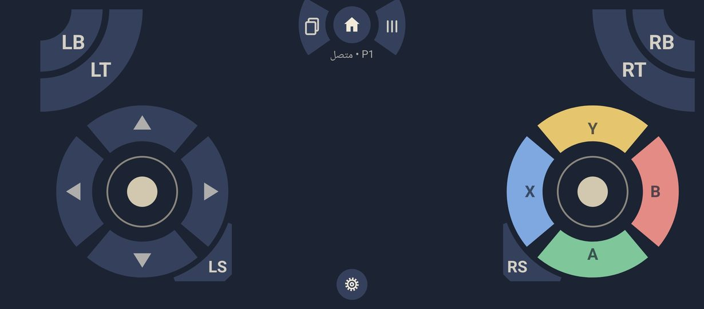
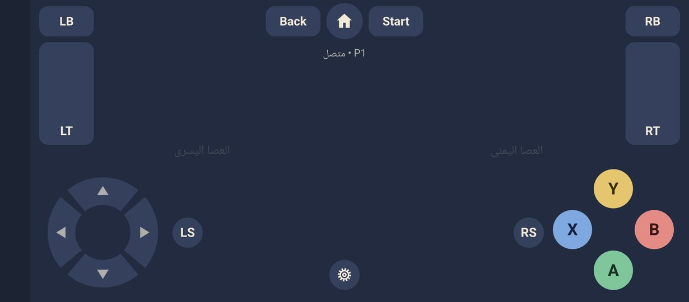
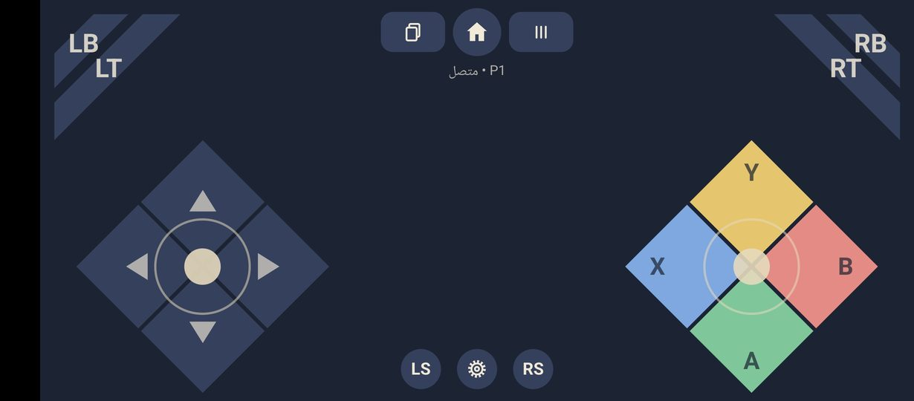

# DOpad

**Turn your phone into a virtual Xbox 360 gamepad — no app, no ads, no certificates.**

[English](README.md) · [العربية](README.ar.md)

DOpad is a tiny server that runs on **Linux (uinput)** or **Windows (ViGEm Bus)** and creates a virtual Xbox 360 controller on your computer. Your phone connects to it over a **WebSocket on plain HTTP**: open the address (or scan the QR code), tap **Start**, and play. It works in every modern mobile browser, including **Safari and Brave on iPhone**.

The whole project is plain Go standard library: **no cgo and no third-party Go dependencies**. On Windows, `ViGEmClient.dll` is loaded through `syscall`.

<p align="center">
  
</p>

| Classic | Diamond |
|---|---|
|  |  |

---

## Table of contents

1. [Features](#features)
2. [Quick start](#quick-start)
3. [Requirements](#requirements)
4. [Using DOpad](#using-dopad)
5. [Hotspot mode (no router)](#hotspot-mode-no-router)
6. [Bluetooth mode (no Wi-Fi)](#bluetooth-mode-no-wi-fi)
7. [Configuration](#configuration)
8. [Windows notes](#windows-notes)
9. [Linux notes](#linux-notes)
10. [Customizing layouts](#customizing-layouts)
11. [How it works](#how-it-works)
12. [Why WebSocket and not WebRTC](#why-websocket-and-not-webrtc)
13. [Security notes](#security-notes)
14. [Building from source](#building-from-source)
15. [Project structure](#project-structure)
16. [Troubleshooting](#troubleshooting)
17. [Tested on](#tested-on)
18. [Contributing and license](#contributing-and-license)

---

## Features

- **No app, no ads, no account.** The controller is a web page served by the program itself.
- **Works on all modern mobile browsers** over plain HTTP — Chrome, Firefox-based browsers, Safari, Brave — on Android and iPhone.
- **Floating sticks.** The stick ring appears **under your thumb** at the first touch and measures movement from there, so you never need to look at the screen to find it.
- **Fully customizable layouts** in plain JSON: anchors, circles, diamonds, arcs, free-form polygons, analog triggers, and a unified `pad` element that combines buttons and triggers around a shared center.
- **Latch (sticky buttons).** Hold any button for a set time and it stays pressed until you tap it again.
- **Multiple players.** Up to 16 virtual controllers (6 by default), one slot per phone.
- **Tiny and light.** One self-contained binary, a few thousand lines of code, and 8-byte packets.
- **Built-in hotspot mode (Linux)** — the computer itself becomes the Wi-Fi access point, with an embedded DHCP server. No router and no internet required.
- **Bluetooth mode (`-b`)** — same page and same 8-byte packets over Bluetooth instead of Wi-Fi. Works with Android and iPhone, with no app on the phone, and never interferes with either device's Wi-Fi.
- **QR code** printed in the terminal and served as PNG at `/qr`.
- **Local control panel (`dopad-panel`).** A small browser UI bound to
  `127.0.0.1` that switches Wi‑Fi/Bluetooth/Self modes, starts and stops the
  server, shows logs and the live QR code, and edits or exports layouts. It is
  included in every package.
- **Screen stays awake** while playing (Screen Wake Lock, with a silent-video fallback for plain HTTP).
- **Installable as a web app** on iPhone for a true fullscreen experience.

---

## Quick start

### Prebuilt binary

**Linux**

```bash
./DOpad
```

**Windows**

1. Install the **ViGEmBus** driver from the [ViGEmBus releases](https://github.com/nefarius/ViGEmBus/releases) and reboot.
2. Run `DOpad.exe`. Approve the one-time firewall prompt (UAC).

On start, the program prints something like:

```
Interface: /home/user/dopad/web, Players: 6

... QR code ...

Open 🎮DOpad on browser: http://192.168.1.42:8080
```

Open the address on your phone (same Wi-Fi network), pick a player and a layout, and press **Start**.

> The program must stay next to its `layouts/` folder. External-web packages also need `web/`; embedded packages carry the UI inside the binary. Use `DOPAD_WEB` and `DOPAD_LAYOUTS` to point elsewhere.

### From source

```bash
make build        # build ./DOpad and ./dopad-panel
./DOpad           # start the gamepad server
./dopad-panel     # optional: local control panel
```

See [Building from source](#building-from-source).

---

## Requirements

| Item | Details |
|---|---|
| Computer OS | **Linux** (uinput) **or** **Windows** (ViGEm Bus) |
| Network | Phone and computer on the **same local network**, or use [hotspot mode](#hotspot-mode-no-router) (Linux) or [Bluetooth mode](#bluetooth-mode-no-wi-fi) |
| Bluetooth (optional) | `-b` mode: a paired Android/iPhone with Bluetooth tethering or Personal Hotspot. Linux also needs NetworkManager/BlueZ (or root + `bluez-tools` + a DHCP client) |
| Port | TCP **8080** by default (tries up to 8090 if busy) |
| Go | `go >= 1.24` — only if you build from source |
| Linux permissions | Access to `/dev/uinput` (see [Linux notes](#linux-notes)) |
| Windows | **ViGEmBus** driver; `ViGEmClient.dll` (x64) next to the exe or embedded at build time |

---

## Using DOpad

1. On the main menu choose your **player slot** and **layout**, then tap **Start**. Your choice is remembered on the phone.
2. Each slot keeps one persistent virtual controller. If a second phone picks an occupied slot, it takes over that slot; the first phone shows a "restore" option, and the controller in the game does not change.
3. Controllers are created in order (P1, then P2, …). **Pick P1 first** so that game player numbers match.
4. The gear icon (or the layout's menu button) opens the in-game menu: **Continue**, **Exit fullscreen**, **Main menu**.

### Fullscreen on iPhone

iPhone browsers cannot hide the Safari bars programmatically. To get true fullscreen:

1. Open the DOpad page in **Safari**.
2. Tap **Share** → **Add to Home Screen**.
3. Launch **DOpad** from the new icon.

It then opens without browser bars and respects the notch and safe areas. On Android and iPad, the fullscreen button works directly.

### Keeping the screen on

While playing, DOpad requests a **Screen Wake Lock**. Because that API needs a secure context (HTTPS or `localhost`), DOpad also plays a tiny silent video (`wake.webm` / `wake.mp4`) as a fallback that works over `http://192.168…`. Low-power mode on the phone may block both; in that case the device default applies, without any error.

### QR code

The server prints the address as an ASCII QR code in the terminal. A PNG version is available at `http://<address>:8080/qr`.

---

## Hotspot mode (no router)

```bash
sudo ./DOpad -s
# prints the SSID/password line (in Arabic), a QR code, and the phone URL:
# Open 🎮DOpad on browser: http://192.168.50.1:8080
```

`-s` turns the computer **itself** into a Wi-Fi access point (with a built-in DHCP server). It is useful when there is no router or no internet. It is **Linux only**, needs **root**, and relies on **NetworkManager** (`nmcli`). Press `Ctrl+C` once: the access point stops and the original Wi-Fi connection is restored.

> The default hotspot password is `12345678`. **Set your own** with `DOPAD_PASS` (see [Security notes](#security-notes)).

On Windows, `-s` is not supported — run the server normally on your local network.

---

## Bluetooth mode (no Wi-Fi)

```bash
./DOpad -b
```

`-b` carries the same page and the same 8-byte packets over **Bluetooth instead of Wi-Fi**. The phone provides the network link, the computer is the client — that is the only combination that works on Linux, Windows, Android and iPhone without an app on the phone.

**Pair the phone with the computer first**, then run `./DOpad -b`:

- **Android:** enable **Bluetooth tethering** (Settings → Network & internet → Hotspot & tethering → Bluetooth tethering).
- **iPhone:** turn on **Personal Hotspot → Allow Others to Join**, then pair from the computer's Bluetooth settings (Apple requires cellular data to be enabled for this feature).

The server starts **immediately** and keeps running with **zero phones connected** — it never waits, never fails and never asks you to hurry. In the background it keeps trying every paired phone, and prints that phone's URL and ASCII QR code the moment a link comes up.

- **Several phones:** each phone is announced separately as it connects. On Linux they can be connected at the same time (one NetworkManager profile per phone). Windows carries **one Bluetooth link at a time** and moves on to another paired phone automatically if one fails.
- Pair a new phone, unpair one, or toggle tethering at any time: no restart needed.

If two phones advertise the same Bluetooth subnet (two iPhones both use `172.20.10.0/28`), the program keeps the first and prints a clear warning instead of hiding the collision.

**Your Wi-Fi is never touched.** `-b` does not bridge interfaces, does not route, and never installs a default route over Bluetooth, so the computer keeps its own Wi-Fi internet and the phone keeps its own. All four combinations behave as expected:

| Computer Wi-Fi | Phone Wi-Fi | Computer internet | Phone internet | Page over Bluetooth |
|---|---|---|---|---|
| on | off | yes | no | works |
| off | on | no | yes | works |
| on | on | yes | yes | works |
| off | off | no | no | works |

Requirements and notes:

- **Linux:** uses **NetworkManager** and normally needs **no root** (`ipv4.never-default=yes` guarantees no routing). If your distribution restricts NetworkManager to privileged users, add your user to the `network` group or run with `sudo`. If NetworkManager is missing (headless server), it falls back to **root mode** — `sudo ./DOpad -b` using `bluez-tools` and a DHCP client — and says so explicitly.
- **Windows:** pairing is a normal user action; removing the Bluetooth default route needs administrator rights. Run as administrator if you want a hard guarantee that no traffic ever goes over Bluetooth.
- **iPhone caveat:** iOS only offers Bluetooth networking through Personal Hotspot, which requires cellular data to be enabled. The "no internet at all" row is therefore impossible on iPhone — an iOS limitation, not a DOpad one.
- `DOPAD_BT=<MAC>` selects a specific paired phone when several are paired.
- `DOPAD_BT_IFACE=<iface>` uses an already configured interface (manual or root setups).

---

## Configuration

All settings are environment variables:

| Variable | Description | Default |
|---|---|---|
| `DOPAD_PORT` | Listening port | `8080` |
| `DOPAD_ADDR` | Address shown to the phone (normal mode only) | auto-detected |
| `DOPAD_PLAYERS` | Number of player slots (1–16) | `6` |
| `DOPAD_WEB` | Web UI folder | next to the executable |
| `DOPAD_LAYOUTS` | Layouts folder | `layouts/` next to the web folder |
| `DOPAD_IFACE` | Wireless interface for hotspot mode | first wireless interface |
| `DOPAD_SSID` / `DOPAD_PASS` | Hotspot name and password | `DOPad` / `12345678` |
| `DOPAD_BAND` / `DOPAD_CHANNEL` | Hotspot band and channel (2.4 GHz is the most compatible) | `bg` / `6` |
| `DOPAD_SUBNET` | Hotspot subnet prefix | `192.168.50` |
| `DOPAD_BT` | Bluetooth address of the phone to use in `-b` mode | first paired phone |
| `DOPAD_BT_IFACE` | Use an existing Bluetooth network interface (manual/root setup) | unset |

Command-line flags: `-s` (hotspot mode), `-b` (Bluetooth mode). An internal `-fix-firewall` flag is used by the Windows firewall helper.

If port 8080 is busy or blocked, DOpad tries the next ports up to 8090 and updates the printed link and QR code. If none works, it tells you to choose one with `DOPAD_PORT`.

---

## Windows notes

DOpad needs **two different things** on Windows:

- **ViGEmBus driver** — install it from the [ViGEmBus releases](https://github.com/nefarius/ViGEmBus/releases), then reboot.
- **`ViGEmClient.dll` (x64)** — it does **not** come with the ViGEmBus installer. Either place it next to `DOpad.exe`, or **embed it** in the exe: put it at `server/ViGEmClient.dll` before `make build-windows`, so `DOpad.exe` becomes a single distributable file.

At startup the program checks both and prints exactly what is missing. If the server cannot create the controller, the same message appears on the phone with a **Retry** button.

**Firewall.** On first run the program asks for administrator permission **once** (UAC) and adds an allow rule for itself — all network profiles, local network only — and removes any old block rule. If you decline, run it once with *Run as administrator*.

**Button and axis mapping.** The phone's button bits match XInput's `wButtons` exactly, so no conversion table is needed. Axes are converted to `int16` (`XUSB_REPORT`, 12 bytes). Up is positive on both the phone and XInput, so vertical axes are not inverted.

---

## Linux notes

DOpad uses `/dev/uinput` and `ioctl` directly (no cgo). At startup it checks access early and prints a clear message once if it fails.

On some distributions you can run it as-is. If you see a warning about `/dev/uinput`, run once:

```bash
make setup
```

This installs a udev rule (`/dev/uinput` accessible to the `input` group) and adds your user to the `input` group. You may need to log out and back in.

---

## Customizing layouts

A layout is **one `.json` file** in the `layouts/` folder. It describes **what is on the screen, where, and how big**. Colors and shapes of elements are shared by all layouts (`controls.css`). No rebuild and no server restart is needed.

### Workflow

1. Copy `layouts/classic.json` to e.g. `layouts/mine.json`.
2. Change `"name"` — this is the label in the menu (if omitted, the file name is used).
3. **Reload the phone page once** so the new file appears in the layout list.
4. Select it and press **Start**.

For later edits to the same file you do not need to reload: the layout is fetched when you press **Start**. Open the in-game menu → **Main menu** → **Start** again.

A broken file (trailing comma, comment, missing quote) is skipped and the server logs a message that starts with "broken layout" together with the file name. JSON does not allow comments or trailing commas.

### File structure

```json
{
  "name": "Name shown in the menu",
  "elements": [
    { "type": "button", "key": "A", "label": "A", "shape": "round", "color": "a",
      "w": 13, "anchor": "br", "x": 18, "y": 4 }
  ]
}
```

`elements` is an ordered list. Each element has a `type`: `panel`, `button`, `trigger`, `stick`, or `pad`. An unknown type is ignored with a console warning. If no element is a menu button (`"action": "menu"`), one is added automatically at the bottom center so you cannot get stuck.

### Position, size, layers

**Unit `u`.** All numbers are in `u`, roughly **1% of the visible screen height** (also capped at 0.55% of the width on narrow screens). Layouts therefore scale with the phone and are designed for landscape. A string like `"50%"` means a percentage of the screen itself.

**Anchor.** `anchor` picks the reference point; `x` and `y` are offsets **from that point toward the inside of the screen**.

| `anchor` | Reference point |
|---|---|
| `tl` / `tr` | top-left / top-right corner |
| `bl` / `br` | bottom-left / bottom-right corner |
| `tc` / `bc` | middle of the top / bottom edge (element is centered horizontally) |
| `cc` | exact center of the screen |

Default is `tl`.

- With `tl`: `x` moves right, `y` moves down. With `br`: `x` moves left, `y` moves up.
- With `tc`, `bc`, `cc`: positive `x` moves right, negative moves left from the center.
- Negative values are allowed and push the element outside the edge (used to center a `pad` on a corner).
- Left and right anchors automatically add the safe-area inset (notch), so nothing hides behind it.

**Size.** `w` and `h` set width and height. `shape: "round"` buttons use `w` only (square). `size` works only for `stick` and `pad`. Defaults: panel 20×20, pill button 18×10, round button `w=12`, trigger 18×34, stick box 40.

**Layers (`z`).** Optional on every element. **Higher is drawn on top and receives touches first**; ties go to the later element in the file. Defaults: `panel` 0, `stick` with `area` 1, `stick` with a box 4, everything else 3. This is why a button sitting on top of a half-screen stick area catches its own touch first.

### Element types

#### `panel` — decoration (no touch)

| Property | Description |
|---|---|
| `fill` | `true` to fill the background |
| `edge` | `"left"` or `"right"` to draw a divider line on that side |
| `label` | faint text in the middle (e.g. "Left stick") |

#### `button`

| Property | Description |
|---|---|
| `key` | `A B X Y LB RB BACK START HOME LS RS UP DOWN LEFT RIGHT` |
| `action` | `"menu"` for the menu button (instead of `key`) |
| `label` | text (default: the `key`) |
| `icon` | `home`, `view`, `menu`, or `gear` (instead of text) |
| `shape` | `pill` (default) or `round` |
| `color` | `a` green, `b` red, `x` blue, `y` yellow |
| `latch` | milliseconds to hold before it latches (see below) |

A button with neither a valid `key` nor an `action` is ignored, with a console warning.

#### `trigger` — analog trigger (LT / RT)

The value is **0–255** depending on where your finger is inside the rectangle. The first finger that touches it **stays bound** to it until released, even if it leaves the bounds; the value saturates at the nearest end.

| Property | Description |
|---|---|
| `key` | `LT` or `RT` |
| `label` | text (default: the `key`) |
| `at` | `[x, y]` percent, moves the label inside the rectangle |
| `dir` | fill direction (table below) |

| `dir` | Fills from | Drag to increase |
|---|---|---|
| `top` (default) | top | down |
| `bottom` | bottom | up |
| `left` | left | right |
| `right` | right | left |

(`up` and `down` are accepted as aliases.)

#### `stick` — floating analog stick

At the first touch the ring jumps **under your thumb**; movement is measured from that point. On release it returns to its resting place, or disappears.

The touch region is either:

- **`area`**: `"left"` or `"right"` — the whole half of the screen (best for classic layouts), or
- **a box**: `anchor`, `x`, `y`, `size` (or `w`/`h`), with `reach` — the fraction of the radius where a touch may start (default 1).

| Property | Description | Default |
|---|---|---|
| `side` | which stick it controls: `left` / `right` | `left` |
| `ring` | ring diameter | 36 |
| `knob` | knob diameter | 0.43 × `ring` |
| `travel` | maximum knob displacement from the touch point | half of `ring` |
| `rest` | draw the ring while idle | `true` with a box, `false` with `area` |

#### `pad` — unified frame

`pad` is the most powerful element: a square area with coordinates **0–100** and a shared center `(50, 50)`, holding **parts**. Each part is a button or trigger shaped like an arc or polygon around the center. The D-pad, ABXY and the corner shoulder buttons in the Ring and Diamond layouts are built from it.

Frame properties:

| Property | Description | Default |
|---|---|---|
| `size` or `w` / `h` | size | 40 |
| `metric` | `circle` or `diamond` (distance measured as radial or as the sum of axes) | `circle` |
| `spread` | angular tolerance around `angle`, in degrees | 60 |
| `inner` | dead-zone ratio in the middle | 0.2 |
| `reach` | outer touch limit ratio | 1.08 |
| `grow` | distance tolerance around `arc` | 6 |

If you set `inner` or `reach` on the frame explicitly, they replace the limits derived from each part's `arc` (this is how the D-pad and ABXY work). The dead zone also captures touches, so you can put a `stick` with the same box on top of a pad and use the center as a stick.

Part properties:

| Property | Description |
|---|---|
| `type` | `button` (default) or `trigger` |
| `key` | the button (or an array of buttons) |
| `angle` | direction in degrees: **0 up, 90 right, 180 down, 270 left** (derived from the shape if omitted) |
| `arc` | `[r1, r2, a0, a1]` — inner radius, outer radius, start angle, end angle (absolute; negatives such as `-40` allowed) |
| `poly` | `"x,y x,y …"` — a free-form polygon instead of `arc` |
| `sweep` | `[a0, a1]` — angular range for polygons (computed automatically if omitted) |
| `color`, `label`, `icon` | as for buttons |
| `at` | `[x, y]` label position inside the frame (default: the shape's center) |
| `fs` | font size |
| `arrow` | `true` draws an arrow pointing along `angle` |
| `latch` | latch time in ms |

A part with neither `arc` nor `poly` has no visible shape. A `trigger` inside a `pad` **must** have `arc` or `poly`, otherwise it is ignored with a warning. `arc` and `poly` are not supported on standalone buttons.

Trigger direction inside a pad (`dir`):

- `cw` / `ccw` — sector fill that rotates with the shape; the value follows the finger's **angle** (default for arcs).
- `out` / `in` — radial fill, from the inside out or the reverse.
- `top` `bottom` `left` `right` — linear fill inside the bounding box (default for polygons).

For the top-left shoulder use `anchor: "tl"` with angles around `90..180`. For the top-right use `anchor: "tr"` with `180..270` and `"dir": "ccw"` so the fill starts from the top edge.

When parts of the same direction overlap (an inner button and an outer trigger), the part whose **range `r1..r2` is nearest** wins. When distances tie (the diagonals of a D-pad), all matching parts press together, which gives diagonals.

**Stick inside a pad.** Place a `pad`, then a `stick` with the same `anchor`, `x`, `y`, `size`, and a smaller `reach` (e.g. `0.4`). A touch near the center moves the stick; a touch near the edge presses pad parts.

### Latch

An optional property on any button (and on `pad` parts), in milliseconds:

- **Press and hold** for that time → the button stays pressed after you lift your finger (it glows to show it).
- **A single tap** releases it.
- A normal short tap behaves as usual.
- All latched buttons are released automatically when you open the menu or the connection drops, so nothing gets stuck.

```json
{ "type": "button", "key": "LS", "label": "LS", "shape": "round", "w": 10,
  "anchor": "bl", "x": 47, "y": 18, "latch": 500 }
```

Good values: `500` for LS (sprint), `150` for shoulder buttons.

### Recipes

**Minimal working layout**

```json
{
  "name": "Simple",
  "elements": [
    { "type": "stick", "side": "left",  "area": "left" },
    { "type": "stick", "side": "right", "area": "right" },
    { "type": "button", "key": "A", "label": "A", "shape": "round", "color": "a", "w": 14, "anchor": "br", "x": 6,  "y": 6 },
    { "type": "button", "key": "B", "label": "B", "shape": "round", "color": "b", "w": 14, "anchor": "br", "x": 22, "y": 14 },
    { "type": "button", "key": "LB", "label": "LB", "anchor": "tl", "x": 3, "y": 3 },
    { "type": "trigger", "key": "LT", "anchor": "tl", "x": 3, "y": 16, "w": 18, "h": 30 }
  ]
}
```

**Vertical RT you pull upward**

```json
{ "type": "trigger", "key": "RT", "anchor": "tr", "x": 3, "y": 14, "w": 16, "h": 40, "dir": "bottom" }
```

**Shoulder buttons within thumb reach** (above the stick area instead of in the corner)

```json
{ "type": "button",  "key": "LB", "label": "LB", "anchor": "bl", "x": 4, "y": 46, "w": 16 },
{ "type": "trigger", "key": "LT", "anchor": "bl", "x": 4, "y": 58, "w": 16, "h": 30 }
```

**Left-handed layout:** swap every `l` and `r` in `anchor`, swap `side` and `area`, and mirror the `angle` values of pads.

### Common mistakes

| Problem | Cause |
|---|---|
| File does not appear in the menu | invalid JSON, or the phone page was not reloaded after adding it |
| Edit does not show | you did not return to the main menu and press **Start** again |
| Button does nothing | `key` missing or not an uppercase valid name |
| Trigger inside a `pad` is invisible | it needs `arc` or `poly` |
| Stick steals a button's touch | the button's layer is lower — raise its `z` |
| Element is off-screen | check the sign of `x`/`y` for your anchor (offsets go inward) |

For diagnosis open the page with `?debug=1` to see touch counts and events at the top. All layout warnings go to the browser console (on Android you can read it with Chrome remote debugging).

---

## How it works

1. The server serves the web UI from `web/` on disk (or from an embedded copy built with `webembed`) at `/`.
2. On **Start**, the browser opens `ws://host:8080/ws?slot=N`.
3. The page converts touches into a state and sends it as a **8-byte binary packet**:

| Bytes | Type | Content |
|---|---|---|
| 0–1 | `int8` | left stick X, Y |
| 2–3 | `int8` | right stick X, Y |
| 4–5 | `uint16` (little-endian) | button bits |
| 6 | `uint8` | LT |
| 7 | `uint8` | RT |

Button bits (identical to XInput's `wButtons`):

| Button | Bit | Button | Bit |
|---|---|---|---|
| UP | `0x0001` | LB | `0x0100` |
| DOWN | `0x0002` | RB | `0x0200` |
| LEFT | `0x0004` | HOME | `0x0400` |
| RIGHT | `0x0008` | A | `0x1000` |
| START | `0x0010` | B | `0x2000` |
| BACK | `0x0020` | X | `0x4000` |
| LS | `0x0040` | Y | `0x8000` |
| RS | `0x0080` | | |

4. The phone sends a packet **whenever the state changes** (once per animation frame) plus a **50 ms keep-alive heartbeat** to cover lost packets. The server writes the packet to the virtual controller (uinput on Linux, ViGEm on Windows). Vertical axes are inverted on Linux because uinput treats up as negative.
5. If the connection drops, the controller is reset to neutral so no input gets stuck.

HTTP endpoints: `/` (web UI), `/ws` (WebSocket), `/api/layouts` (layout list), `/layouts/` (layout files), `/slots` (slot state), `/manifest.webmanifest`, `/qr` (QR as PNG).

In Bluetooth mode (`-b`), the phone provides a Bluetooth PAN (NAP) and the computer joins as a PANU client. The same HTTP/WebSocket server listens on the PAN interface's IPv4 address; no Wi-Fi bridge and no default route are created.

The WebSocket server is a hand-written, standards-based implementation (`crypto/sha1`, `encoding/binary`, `net`). Frames are limited to 64 KB, fragmented frames are not needed for 8-byte messages, and the HTTP server uses a header read timeout against Slowloris-style connections.

---

## Why WebSocket and not WebRTC

All browsers on **iOS** (Safari, Chrome, Brave — they all use WebKit) require a **secure HTTPS context** to use WebRTC (`RTCPeerConnection`). That means generating a self-signed certificate, sending it to the phone, and trusting it in the settings — too much friction.

**WebSocket over HTTP** avoids all of this: no certificate, every browser supports it, nothing to configure on the phone, and a single TCP port instead of a range of UDP ports. The game data is tiny (8 bytes), so on a local network the difference from UDP is not noticeable.

---

## Security notes

- DOpad is designed for **your own home network or your own hotspot**. There is **no authentication**: any device on the same network that opens the page can take a player slot.
- Traffic is plain HTTP; do not use it on untrusted or public networks.
- The default hotspot password (`12345678`) is public knowledge. **Set `DOPAD_PASS`** before using `-s` anywhere others might be nearby.
- On Windows the firewall rule it adds is limited to the local network.
- Bluetooth mode (`-b`) only talks to phones already paired with the computer; the phone provides the PAN link. It still has no app-level authentication, so use it only with your own devices.

---

## Building from source

```bash
make build            # Linux binary: ./DOpad, plus ./dopad-panel
make build-panel      # local control panel only: ./dopad-panel
make build-windows    # Windows binary: ./DOpad.exe (cross-compiles from Linux)
make setup            # Linux: udev rule + input group (once, if needed)
make dist             # four ready-to-run folders in dist/ (see below)
```

Directly on Windows (cmd):

```bat
cd server
set CGO_ENABLED=0
go build -trimpath -ldflags="-s -w" -tags vigemdll -o DOpad.exe .
```

Omit `-tags vigemdll` if you prefer to keep `ViGEmClient.dll` next to `DOpad.exe` instead of embedding it.

If `server/ViGEmClient.dll` exists, `make build-windows` embeds it using the `vigemdll` build tag, producing a single-file `DOpad.exe`.

**Two variants per OS.** `make dist` produces both variants at once in four folders under `dist/` (regenerated on every run; the version comes from the latest Git tag and can be overridden with `make dist V=1.2.3`):

| Folder | Web UI | Contents |
|---|---|---|
| `dist/DOpad-<version>-linux/` | embedded | `DOpad`, `dopad-panel`, `web/controls.js`, `layouts/`, `THIRD_PARTY_NOTICES.md` |
| `dist/DOpad-<version>-linux+web/` | external `web/` | `DOpad`, `dopad-panel`, `web/`, `layouts/`, `THIRD_PARTY_NOTICES.md` |
| `dist/DOpad-<version>-windows/` | embedded | `DOpad.exe`, `dopad-panel.exe`, `web/controls.js`, `layouts/`, `THIRD_PARTY_NOTICES.md` |
| `dist/DOpad-<version>-windows+web/` | external `web/` | `DOpad.exe`, `dopad-panel.exe`, `web/`, `layouts/`, `THIRD_PARTY_NOTICES.md` |

The binary keeps the same name inside each folder. The embedded variants do **not** include the full `web/` folder, because an external `web/` always takes priority at runtime; they include only `web/controls.js` so the panel editor can read the control catalog. `layouts/` stays external in every variant so you can edit it. On Windows, `ViGEmClient.dll` is embedded when `server/ViGEmClient.dll` exists.

**Smaller, reproducible binaries.** The Makefile already builds with `-ldflags="-s -w"` (strips the symbol table and debug information) and `-trimpath` (removes local filesystem paths from the binary). If you build manually, add the same flags. `-ldflags="-s -w"` typically shrinks the binary by about 30% (for example from ~11 MB to ~7.6 MB) with no effect on performance. The Makefile also sets `CGO_ENABLED=0`, so the Linux binary is statically linked and does not depend on the host's libc.

---

## Project structure

```
dopad/
├── Makefile
├── README.md / README.ar.md
├── LICENSE
├── docs/
│   ├── images/                # images used in the READMEs
│   └── THIRD_PARTY_NOTICES.md
├── gui/panel/                 # local control panel (separate Go module)
│   ├── main.go                # loopback HTTP server, API, settings
│   ├── manager.go             # DOpad process lifecycle and logs
│   ├── catalog.go             # reads web/controls.js at runtime
│   ├── layouts.go             # list/load/save layouts
│   └── web/                   # panel UI (embedded in the binary)
├── server/                    # Go module
│   ├── go.mod
│   ├── main.go                # HTTP + WebSocket + slots + -s / -b mode (platform independent)
│   ├── pad_linux.go           # virtual gamepad via uinput + ioctl
│   ├── pad_windows.go         # virtual gamepad via ViGEm Bus (syscall, no cgo)
│   ├── ap.go                  # hotspot + embedded DHCP server (Linux only)
│   ├── selfmode_linux.go      # start/stop of -s mode on Linux
│   ├── selfmode_windows.go    # rejects -s on Windows
│   ├── btmode_common.go       # Bluetooth mode: shared helpers
│   ├── btmode_linux.go        # Bluetooth PAN via NetworkManager / BlueZ
│   ├── btmode_windows.go      # Bluetooth PAN via Winsock + Bluetooth APIs
│   ├── btmode_other.go        # rejects -b on other systems
│   ├── qr.go                  # QR generation (standard library only)
│   ├── firewall_windows.go / firewall_other.go
│   ├── web_embed.go           # optional webembed: embed web/ inside the binary
│   └── vigem_*_windows.go     # embed / do not embed ViGEmClient.dll
├── layouts/                   # every .json file = one layout in the menu
│   ├── classic.json
│   ├── diamond.json
│   └── ring.json
└── web/                       # read from disk — edit and reload, no rebuild
    ├── index.html             # main menu
    ├── controls.css           # shared styling for all layouts
    ├── controls.js            # touch engine + element catalog + connection
    ├── manifest.webmanifest   # install as web app (iPhone fullscreen)
    ├── icon-*.png / favicon-32.png
    └── wake.mp4 / wake.webm   # silent video to keep the screen on
```

To embed the web UI into the binary, copy `web/` to `server/web/` before building. `make build` and `make build-windows` then detect it and add the `webembed` tag automatically. An external `web/` folder next to the binary always takes priority.

---

## Troubleshooting

| Symptom | What to check |
|---|---|
| Phone cannot open the page | Same network? Firewall? Try the port shown in the terminal (it may have moved from 8080). On Windows, allow the UAC firewall prompt. |
| "Cannot create controller" on the phone | Linux: `/dev/uinput` permissions (`make setup`). Windows: ViGEmBus driver and `ViGEmClient.dll`. The terminal prints which one is missing. |
| Game does not see the controller | Start DOpad **before** the game, and pick P1 first. |
| Layout missing from the menu | Invalid JSON or the page was not reloaded. Check the server log. |
| iPhone shows browser bars | Use **Add to Home Screen** and open from the icon. |
| Screen turns off while playing | Phone low-power mode can block wake lock and the fallback video. |
| Hotspot does not start | Needs root, NetworkManager (`nmcli`), and a Wi-Fi card that supports AP mode. |
| Bluetooth mode never finds the phone | Pair the phone first, then enable Bluetooth tethering (Android) or Personal Hotspot (iPhone, cellular data required). On Linux check `bluetoothctl`/NetworkManager; the root fallback needs `bluez-tools` and `dhcpcd`/`udhcpc`. |
| Bluetooth link is up but the page does not open | Use the URL printed when the link comes up. On Windows, run as administrator once to remove the Bluetooth default route, or set `DOPAD_BT=<MAC>` to choose a phone. |
| `/qr` returns 404 in Bluetooth mode | Normal until the first phone connects; the QR code is generated when the link is up. |

---

## Tested on

- **Server:** Linux and Windows.
- **Bluetooth mode:** Linux server with an Android phone.
- **Browsers:** Chrome and Mull on Android; Safari, Brave, and Chrome on iPhone.
- **Real use:** a continuous 3–4 hour co-op session of *Cult of the Lamb* with no issues.

---

## Contributing and license

The project is small and focused; the structure above shows where each part lives.

Release notes are in [CHANGELOG.md](CHANGELOG.md).

### License

DOpad is released under the **[0BSD license](LICENSE)**: use it, copy it, modify it, sell it — with no conditions, no attribution required. It comes with no warranty.

The Windows build uses **ViGEmClient** (MIT license) and needs the separately installed **ViGEmBus** driver (BSD-3-Clause). Their terms are in [docs/THIRD_PARTY_NOTICES.md](docs/THIRD_PARTY_NOTICES.md). If you redistribute `DOpad.exe`, keep that file with it.